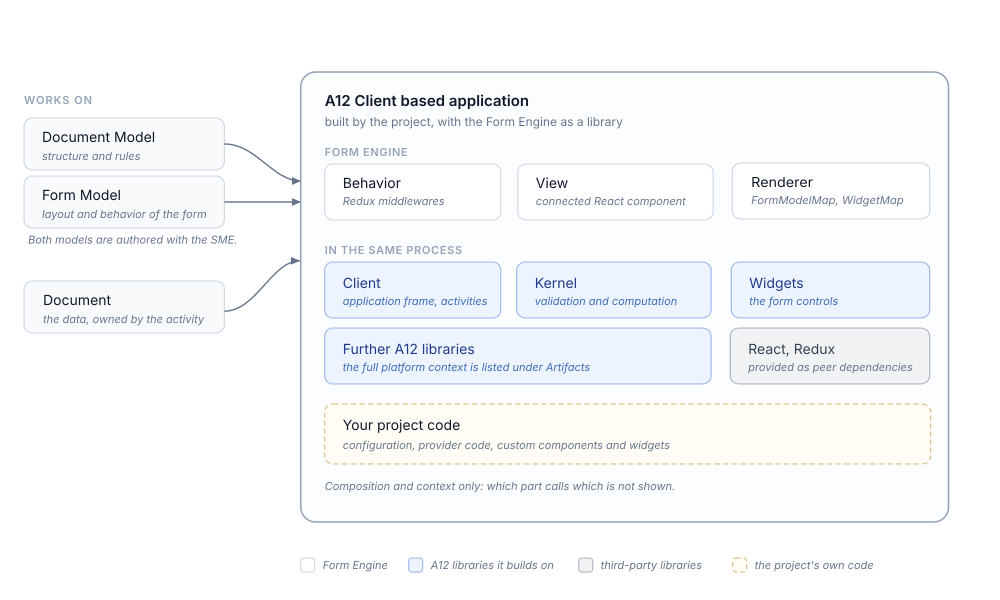

////
SPDX-License-Identifier: EUPL-1.2 OR LicenseRef-commercial

Copyright (c) 2012-2026 mgm technology partners GmbH

Dual License
------------
This source file is part of the mgm A12 Platform and available under
a choice of two different licenses:

1. Open-Source License - EUPL v1.2
   You may redistribute and/or modify this file under the terms of the
   European Union Public License, version 1.2 - see https://eupl.eu/.

2. Commercial License
   Alternatively, you may obtain a commercial license from
   mgm technology partners GmbH, that permits use of this software
   under different terms (including support and maintenance services).

   Please contact a12-license@mgm-tp.com for more information.

You must select and comply with exactly one of the above license options.

Warranty Disclaimer (applies to either option)
----------------------------------------------
THIS SOFTWARE IS PROVIDED "AS IS" AND WITHOUT WARRANTY OF ANY KIND,
WHETHER EXPRESS OR IMPLIED, INCLUDING BUT NOT LIMITED TO THE WARRANTIES
OF MERCHANTABILITY, FITNESS FOR A PARTICULAR PURPOSE AND
NON-INFRINGEMENT, EXCEPT WHERE SUCH DISCLAIMERS ARE HELD TO BE
LEGALLY INVALID. SEE THE RESPECTIVE LICENSE TEXT FOR DETAILS.
////

[#form-engine_introduction]
= Introduction

[#form-engine_introduction_functionality]
== Functionality

The Form Engine renders the forms of an A12 application — the data-entry user interface in which users view and edit documents.
It interprets Form Models, which define the layout and behavior of a form for a given Document Model, so applications get their forms from models instead of hand-coded user interface development.

At runtime, the Form Engine displays a single document in read-only or editable form, tracks the form's data and user-interface state while the user works, and provides immediate validation and computation feedback.
The business rules themselves are not evaluated by the Form Engine:
validation and computation are delegated to the Kernel, so the rules modeled in the Document Model apply identically everywhere.

The Form Engine does not render table or list views over document collections — that is the Overview Engine — nor hierarchical tree views (Tree Engine) or static, content-driven pages (Content Engine).

Please refer to the link:/docs/OVERALL/what_is_a12/index.html#_engines[Overall Documentation] for general information about engines.

It does not define the data structures, the rules or the ui either:
Document Models defining the data structure, validation and computation rules and Form Models defining the Form UI are authored with the Simple Model Editor (SME).
For user-interface components outside forms, use the Widgets library directly.

Looking for modeler or analyst documentation? Please have a look at the link:/docs/SME/sme-fm-ba-docs/index.html[Form Model Editor Documentation].

[#form-engine_introduction_architecture]
== Architecture

The Form Engine is an interpreter of Form Models, built on a strict split between behavior and view:
the behavior is implemented via Redux middlewares and reducers, the view as connected React components.
It is integrated into an A12 client application through an activity, which owns the displayed document and the Form Engine Redux state.
For the internal Redux flow — state, selectors, renderer, dispatch configuration, middlewares, reducers — see the <<form-engine_architecture,Architecture>> chapter.

.Form Engine overview

The engine, the A12 libraries it builds on, and the project's own customizations all run inside the client application in the browser — none of them is a separate service.
Validation and computation of the edited document are delegated to the Kernel, and the form controls are rendered with the A12 Widgets library;
the full platform context the consuming application must provide is listed under <<form-engine_introduction_artifacts,Artifacts>>.

Interaction follows an event/command flow.
Events ("something happened") are the stable contract an application may listen to; which commands the engine fires internally is deliberately not a contract and may change between releases.

Customization surfaces, in increasing depth: configuration parameters, provider code, and custom widgets — project-supplied React components that are treated exactly like the built-in widgets, with full access to the engine's internal runtime model.
Custom components are registered through the two rendering maps: `FormModelMap` binds high-level Form Model elements to components, `WidgetMap` binds low-level widget types to components.

The engine ships as npm packages with readable, non-obfuscated sources and TypeScript source maps, which keeps debugging into engine code practical.

Do you want to integrate the Form Engine into your Client application? Please consult the chapter <<form-engine_integration>>. The Form Engine package provides dedicated integration components.

[#form-engine_introduction_artifacts]
== Artifacts

The entry points a project declares in its build or invokes on the command line — not the full set of published modules (npm scope `@com.mgmtp.a12.formengine`, Maven group `com.mgmtp.a12.formengine`):

[cols="2,3"]
|===
| Artifact | Purpose

| `formengine-core` (npm)
| The Form Engine: behavior and view. Import from the package root only.

| `formengine-content-elements`, `formengine-content-elements-editor` (npm, experimental)
| Form-Engine-style controls for use inside Content Models, and their editor components.

| `formengine-model-migration` (npm)
| The Form Model migration tool.

| `formengine-model` (Maven)
| Java representation of the Form Model, with serialization and validation — for server-side processing of Form Models.
|===

`formengine-core` declares its platform context as peer dependencies, provided by the consuming application:
`kernel-md-facade`, `client-core`, `dataservices-access`, `widgets-core`, `expression-core`, `base-model-api`, the Utils connector and localization packages, React, and Redux.

[#form-engine_introduction_technologies]
== Technologies

* TypeScript, delivered as modern ECMAScript modules via npm.
* React for the view, Redux for state management — both provided by the consuming application as peer dependencies.
* Java for the server-side Form Model artifact.

[#form-engine_introduction_terminology]
== Terminology

[cols="1,3"]
|===
| Term | Meaning

| Form Model
| The model defining a form's layout and behavior for a Document Model; authored with the Simple Model Editor (SME), interpreted by the Form Engine.

| FormModelMap / WidgetMap
| The two rendering registries and the central customization seam: `FormModelMap` binds Form Model elements to React components, `WidgetMap` binds widget types to React components.

| Event / Command
| Event Actions report what happened and are the stable contract for applications to react to; Command Actions lead to the engine's internal state changes and are not a contract.

| Enablement State
| Two orthogonal aspects of a form's condition: editable versus read-only, and enabled versus disabled.
|===
